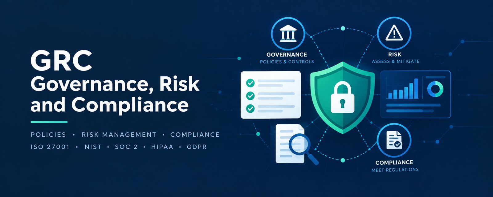

# GRC Audit — Incident → Framework Diagnostic & Remediation

**▶ Live:** [cybersecinfo.com/grcaudit](https://cybersecinfo.com/grcaudit/) · mirror on [GitHub Pages](https://ahuttener.github.io/GRC-Audit/)

**Companion project:** [Identity Governance Audit Framework](https://github.com/ahuttener/identity-governance-audit-framework),
a full simulated audit engagement (SOC 2 Type 2 integrated with an ISO/IEC 27001 surveillance audit): risk assessment,
control testing workpapers, findings and remediation.

**Describe a security incident in plain language. Get an auditor-grade, framework-mapped
diagnosis — with control IDs verified against official catalogs, not hallucinated.**


A production-style web app by [CyberSecInfo](https://cybersecinfo.com). It translates a
real-world incident, misconfiguration or audit finding into:

1. **Severity + failure category** (Critical/High/Medium/Low).
2. **Grounded multi-framework mapping** — NIST CSF 2.0, ISO/IEC 27001:2022, SOC 2,
   GDPR, CCPA/CPRA, HIPAA and **AIUC-1** (the AI agent standard), with the exact control/article IDs.
   AIUC-1 is cited only when an AI system or agent is part of the incident (prompt injection,
   unauthorized agent actions, hallucinations, shadow AI); otherwise it is marked N/A.
3. **Audit evidence** an assessor will request (logs, tickets, policies).
4. **A 3-step remediation roadmap** — immediate containment → leak investigation &
   legal/notification (e.g. GDPR 72h) → permanent systemic fix.

Then **Copy** or **Export to Markdown**.

---

## Anti-hallucination: local grounding (lightweight RAG)

The app does **not** rely on broad LLM memory for control IDs. Official framework catalogs
are embedded in [`src/data/frameworks/`](src/data/frameworks/):

| File | Catalog |
|---|---|
| `nist-csf-2.0.json` | NIST CSF 2.0 functions, categories & subcategories (PR.AA, GV.SC, DE.CM…) |
| `iso-27001-2022.json` | **All 93** ISO/IEC 27001:2022 Annex A controls |
| `gdpr-official.json` | Key GDPR articles (Art. 5, 25, 32, 33, 34, 44…) |
| `hipaa-security-privacy.json` | 45 CFR §164.308/.312/.400 Security & Breach rules |
| `soc-2-tsc.json` | AICPA Trust Services Criteria (CC1–CC9, A/C/P) |
| `ccpa-cpra.json` | Cal. Civ. Code §1798.100 / .81.5 / .82 / .150… |

On every request the engine:

1. **Retrieves** the most relevant controls from the catalogs and injects them into the
   prompt (`src/lib/grounding.ts → retrieveContext`).
2. Instructs the model to **cite only IDs that appear in that context** (strict system
   prompt in `src/lib/prompt.ts`).
3. **Verifies** every cited ID against the catalogs after generation (`verify()`), and the
   UI shows a green *"Grounded — N control IDs verified"* badge (or flags any unverified ID).
   Matching is strict: an ID must exist as-is, as a finer sub-reference (`Art. 5(1)(f)` → `Art. 5`,
   `1798.100(e)` → `1798.100`) or inside a catalog range (`Art. 17` → `Art. 15-22`). Look-alikes
   such as `Art. 3` vs `Art. 32`, `Art. 50` vs `Art. 5` or `A.5.1` vs `A.5.18` are rejected — this is
   covered by the test suite.

The built-in **demo engine** draws its IDs straight from the catalogs, so it is always 100% grounded.

---

## Runs with zero setup (demo mode)

Without any API key the app uses a local analysis engine with four curated, framework-accurate
scenarios plus a keyword classifier for free text — enough to run and demo everything.

Add a key to enable full LLM analysis of **any** incident.

```bash
npm install
cp .env.example .env.local      # optional — add a key for LLM mode
npm run dev                     # http://localhost:3000
```

### Configure the API key (`.env.local`)

```bash
# Optional. Without a key, the app runs in demo mode.
ANTHROPIC_API_KEY=sk-ant-...        # Claude (used if set)
# OPENAI_API_KEY=sk-...             # OpenAI (alternative)
# LLM_MODEL=claude-haiku-5-5        # default; or claude-sonnet-5-5 / gpt-4o-mini
```

> **Note:** an Anthropic **API key** (console.anthropic.com, pay-as-you-go) is separate from a
> Claude.ai subscription. The key is read server-side from the environment — it is never shipped
> to the browser and must never be committed.

---

## Quick-test scenarios

One-click pills load realistic audit findings: **Zombie Account**, **Public API Key & Secret
Exposure**, **Customer Data Leak via Unencrypted Channel**, **Missing MFA on Cloud Infrastructure**,
and 18 more across vulnerability management, governance and AI.

Four **identity governance** scenarios — standing privileged access and break-glass, a rubber-stamped
quarterly access review, an ownerless service account, and a segregation-of-duties conflict after a
role change — are drawn from the controls and test procedures (IAM-06, IAM-08, IAM-09, IAM-10) of the
companion [Identity Governance Audit Framework](https://github.com/ahuttener/identity-governance-audit-framework).

## Response schema (`POST /api/audit-incident`)

Returns `{ source, model?, verification, result }`, where `result` matches
[`src/types/grc.ts`](src/types/grc.ts): `incident_title`, `incident_summary`, `severity_level`,
`failure_category`, `grounded_frameworks` (the seven framework objects; `aiuc_1` is "N/A" when no AI is involved), `audit_evidence_required`,
and `remediation_plan` (three steps).

## Tests

```bash
npm test      # Vitest
```

The suite covers the grounding verifier (real IDs accepted, look-alike IDs rejected, every demo
scenario fully grounded) and the API rate limiter. CI runs it before every GitHub Pages deploy.

## Project structure

```
src/
  app/
    page.tsx                     dashboard (client)
    api/audit-incident/route.ts  grounding → LLM or demo → verify
  components/                    Header, IncidentConsole, ResultView,
                                 FrameworkMatrix, EvidenceCard, RemediationRoadmap, …
  data/
    frameworks/*.json            embedded official catalogs (grounding source)
    scenarios.ts                 the 22 quick-test scenarios
  lib/
    grounding.ts                 retrieve + verify against catalogs (+ grounding.test.ts)
    rateLimit.ts                 credit protection for the API route (+ rateLimit.test.ts)
    prompt.ts / llm.ts           grounded prompt + Anthropic/OpenAI call
    analyzer.ts                  local demo engine (grounded)
    toMarkdown.ts                export
  types/grc.ts                   response schema
php/
  audit-incident.php             AI endpoint for PHP hosts (Hostinger)
```

## Deploy

- **cybersecinfo.com/grcaudit (Hostinger, PHP — no Node needed):** `bash scripts/package-hostinger.sh`
  builds the static site plus `api/audit-incident.php`, which calls Claude with structured outputs,
  accepts calls only from the site's own origin, and caps usage at 10 analyses per visitor per hour
  and 150 per day. The key lives in `grcaudit-config.php` **outside** `public_html`. Steps:
  [`hosting/COMO-INSTALAR.txt`](hosting/COMO-INSTALAR.txt).
- **GitHub Pages (demo engine):** every push to `main` runs the tests and publishes
  [ahuttener.github.io/GRC-Audit](https://ahuttener.github.io/GRC-Audit/).
- **Node / Vercel (optional):** `npm run build && npm run start` with `ANTHROPIC_API_KEY` set; the
  Next.js route applies the same limits (`AI_PER_IP_HOURLY`, `AI_DAILY_LIMIT`). Two honest caveats:
  the counters live in memory, so on serverless each instance counts separately and resets on a
  cold start; and `X-Forwarded-For` is only trusted on Vercel or with `TRUST_PROXY=1` behind your
  own proxy (otherwise every caller shares one hourly bucket, so spoofing the header gains nothing).
  For a hard global ceiling, also set a **spend limit** on the key's workspace in the Claude Console.

## Disclaimer

Educational / portfolio project. Automated output is an indicator to support an assessor, not a
certification or legal advice. Confirm every finding and notification deadline against the
primary source and qualified counsel.

## License

[MIT](LICENSE)

Built by **Adriano Huttener** — MSc Cybersecurity (National College of Ireland) · [CyberSecInfo](https://cybersecinfo.com)
